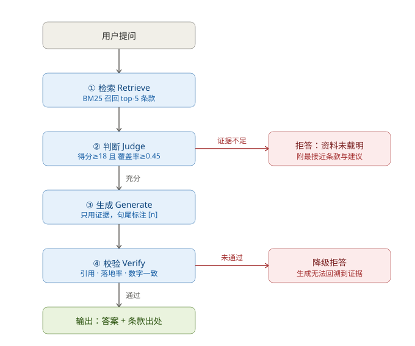
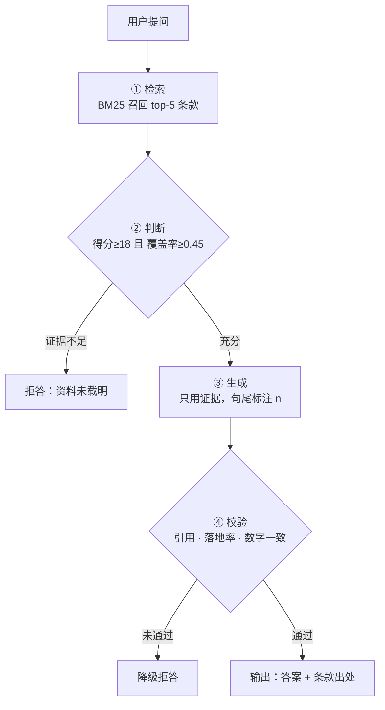

# 带出处引用的制度知识问答系统

> 仓库：<https://github.com/Zzz04W/student-regulation-grounded-qa>

基于《大连财经学院学生管理规定》（7 章 82 条）构建的可溯源问答系统。
核心目标只有两条：**每个答案都能回溯到具体条款**，**没有依据的问题必须拒答**。

知识资料同时被制作为 **RAG 资料库** 与 **问答技能** 两种形态，并做了同题对比测试。

---

## 一、四环节流程





| 环节 | 作用 | 关键设计 |
|---|---|---|
| ① 检索 | 按条召回候选证据 | BM25 over 中文 uni/bi-gram；以「条」为最小引用单元 |
| ② 判断 | **拒答第一道闸** | 得分 ≥18 **且** 术语覆盖率 ≥0.45，双门槛 |
| ③ 生成 | 仅依据证据作答 | 输出条款原文 + `[n]` 引用标记 |
| ④ 校验 | **拒答第二道闸** | 引用完整性 / 落地率 ≥0.60 / 数字一致性 |

完整设计说明见 [`orchestration/flow-design.md`](orchestration/flow-design.md)，
平台无关编排定义见 [`orchestration/workflow.yaml`](orchestration/workflow.yaml)。

---

## 二、测试结果

**14 条用例（10 条可答 + 4 条无依据）全部通过。**

| 指标 | 结果 |
|---|---|
| 可答题正确率 | 10 / 10 |
| **无依据题拒答率** | **4 / 4** |
| 出处可追溯率 | 100% |
| 校验通过率 | 100% |

### 拒答逻辑实测（无依据问题）

| 编号 | 问题 | 触发原因 | 覆盖率 | 得分 |
|---|---|---|---|---|
| R1 | 图书馆借书逾期的罚款标准是多少？ | `PARTIAL_EVIDENCE` | 0.167 | 10.25 |
| R2 | 学生宿舍晚上几点熄灯，门禁几点？ | `NO_EVIDENCE` | 0.045 | 3.13 |
| R3 | 学校本科学费每年多少钱？ | `NO_EVIDENCE` | 0.250 | 7.73 |
| R4 | 一等奖学金的奖金金额是多少？ | `PARTIAL_EVIDENCE` | 0.294 | 22.17 |

R3、R4 是特意设计的**边界陷阱题**：文档中确实提到「按规定缴纳学费」「发给奖品或奖金」，
但没有任何金额。术语覆盖率判据能识别这种"主题相关但不支持结论"的情况并正确拒答——
这正是单一相似度阈值做不到的地方。

### 校验节点拦截演示

向生成节点强制注入幻觉答案「图书馆图书逾期每天罚款 0.5 元，宿舍每晚 23:30 熄灯」：

| 校验项 | 结果 | 说明 |
|---|---|---|
| citation_validity | 通过 | 引用编号 [1] 在范围内 |
| groundedness | **拦截** | 落地率 0.0959 < 0.60 |
| numeric_consistency | **拦截** | 0.5 / 23 / 30 三个数字未在证据中出现 |

最终降级为拒答（`VERIFY_FAILED`）。

完整明细见 [`results/测试报告.md`](results/测试报告.md) 与 `results/run_log.json`。

---

## 三、RAG 资料库 vs 问答技能

| 指标 | RAG 编排 | 问答技能 |
|---|---|---|
| 可答题正确 | 10/10 | 10/10 |
| **无依据题拒答** | **4/4** | 0/4 |
| 总体准确率 | **100%** | 71% |
| 单次上下文开销 | 约 523 字 | 约 8572 字（**16.4×**） |
| 引用强制性 | 结构化、强制校验 | 提示词约束、无校验 |

两种形态在**可答题上表现一致**，差距全部集中在**拒答能力**：
技能模式缺少判断节点，只要检索到相关条款就会组织答案，
在边界陷阱题上会给出误导性回答。

详见 [`results/对比测试.md`](results/对比测试.md)。

---

## 四、快速开始

```bash
# 1. 构建语料索引（从 docx 清洗为 82 条）
python src/build_corpus.py

# 2. 单条问答
python src/ask.py "学生请假3天以上、7天以内由谁批准？"

# 3. 跑测试集 + 生成报告
python src/run_tests.py
python src/gen_compare.py
```

依赖只有 PyYAML（已随仓库 `.vendor` 提供；仅需标准库时可直接用 `chunks.jsonl`）。

### 输出示例

```json
{
  "type": "ANSWER",
  "answer": "学生请假时间在1天以内的由所在年级专业辅导员批准；……请假时间在3天以上、7天以内的，由学生处批准； [1]",
  "sources": [
    { "ref": 1, "id": "第22条", "path": "第三章 学籍管理规定 > 第二节 考核与成绩记载" }
  ],
  "metrics": { "score_raw": 42.44, "coverage": 0.545 }
}
```

---

## 五、目录结构

```
student-rag-qa/
├── corpus/                      # RAG 资料库
│   ├── 学生管理规定.md           # 按条编号的可读语料
│   └── chunks.jsonl             # 检索索引（82 条）
├── orchestration/
│   ├── workflow.yaml            # 四环节编排定义（平台无关）
│   ├── flow-design.md           # 流程设计说明
│   └── flow.svg                 # 流程图
├── src/
│   ├── build_corpus.py          # 语料构建
│   ├── retriever.py             # ① 检索：BM25
│   ├── engine.py                # 编排引擎：②③④ 节点与分支
│   ├── run_tests.py             # 测试执行
│   ├── gen_compare.py           # 对比报告生成
│   └── ask.py                   # 命令行问答
├── skill/学生管理规定问答/        # 问答技能
│   ├── SKILL.md
│   └── references/学生管理规定.md
├── tests/questions.json         # 测试集（10 可答 + 4 无依据）
└── results/                     # 测试报告与运行日志
```

---

## 六、已知局限

- 生成器当前为 grounded-extractive（确定性抽取），保证零幻觉但表达不够口语化；
  设置 `OPENAI_API_KEY` 后可切换为大模型生成，此时校验节点的拦截价值会真正体现。
- BM25 为字面匹配，对同义改写（如「旷课」vs「无故缺席」）召回有限，
  生产环境建议叠加向量召回做混合检索。
- 判定阈值基于本测试集标定，换语料需重新标定（标定方法见 `flow-design.md`）。
