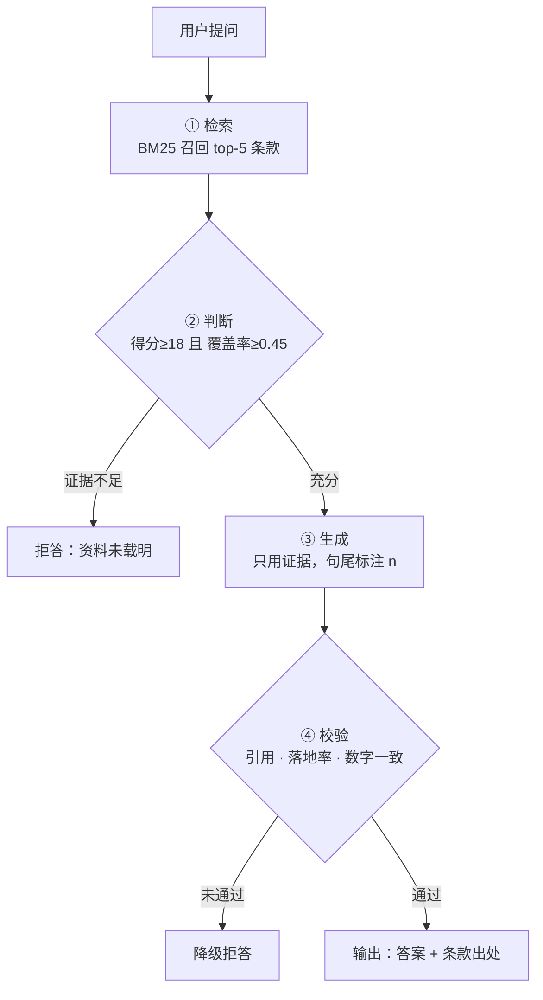

# 流程设计说明

## 一、设计目标

基于《大连财经学院学生管理规定》构建知识问答系统，满足两条硬性约束：

1. **出处可追溯**：每个答案必须能回溯到具体条款（第 X 条 · 第 X 章 > 第 X 节）；
2. **拒答可控**：资料库中没有答案的问题必须明确拒答，不得编造。

## 二、四环节设计

### ① 检索（Retrieve）

- **输入**：用户问题
- **实现**：BM25 over 中文字符 uni/bi-gram，召回 top-5 条款
- **为何不用向量**：条款文本短、术语密集，字面匹配召回更稳；零依赖、结果完全可复现，便于回归测试
- **输出**：证据列表 `{rank, id, chapter, section, text, score}`
- **分块策略**：以「条」为最小可引用单元（共 82 条），引用粒度天然对齐制度文本的组织方式

### ② 判断（Judge）—— 拒答第一道闸

用**双重门槛**判定证据是否足以支撑作答，避免单一指标的误判：

| 指标 | 含义 | 阈值 |
|---|---|---|
| `score_raw` | 首条证据的 BM25 绝对分 | ≥ 18.0 |
| `coverage` | 问题术语在首条证据中的加权覆盖率（bi-gram 权重 2，uni-gram 权重 1） | ≥ 0.45 |

- 两个条件**同时满足** → `ANSWER`，进入生成节点
- 覆盖率不足但有一定相关性 → `ABSTAIN / PARTIAL_EVIDENCE`
- 完全不相关 → `ABSTAIN / NO_EVIDENCE`

阈值来自实测标定：14 条用例中，可答题覆盖率落在 **0.545 ~ 0.889**，无依据题落在 **0.045 ~ 0.389**，中间留出 0.45 这一安全分隔带（详见 `results/测试报告.md` 标定表）。

> 关键设计：`coverage` 是拒答的**主判据**。因为 BM25 归一化后首条得分恒为 1.0，无法区分"真的匹配"与"矬子里拔将军"；覆盖率直接刻画"问题里的关键词有多少能在证据中找到"，能识别「文档只写了按规定缴纳学费，却问学费多少钱」这类**边界陷阱题**。

### ③ 生成（Generate）

- 默认输出**完整条款原文**（去掉条号前缀），避免断章取义；条款超过 300 字时才用连续窗口定位最相关片段
- 句尾强制附加引用标记 `[n]`，`n` 对应证据编号
- 次条证据得分 ≥ 0.85 倍时并入作为补充依据，标注 `[2]`
- 生成器为 grounded-extractive（确定性兜底），设置 `OPENAI_API_KEY` 后可切换为真实大模型，校验节点的作用会更明显

### ④ 校验（Verify）—— 拒答第二道闸

三项检查全部通过才允许输出：

| 检查项 | 规则 | 作用 |
|---|---|---|
| `citation_validity` | 答案中所有 `[n]` 必须落在证据编号范围内 | 防虚构引用 |
| `groundedness` | 答案术语在被引证据中的覆盖率 ≥ 0.60 | 防无据发挥 |
| `numeric_consistency` | 答案中的数字必须能在被引证据原文中找到 | 防数值幻觉 |

任一失败 → 降级为拒答（`VERIFY_FAILED`）。校验前先剥离 `[n]` 标记，避免引用编号被误判为答案数字。

## 三、为什么设置两道闸

- **判断节点**拦的是「资料库根本没有」——事前拦截，成本低
- **校验节点**拦的是「有资料但生成跑偏」——事后拦截，兜住大模型幻觉

两者职责不同，缺一不可。实测中向生成节点注入一条含幻觉的答案
（"图书馆图书逾期每天罚款 0.5 元，宿舍每晚 23:30 熄灯"），
校验节点以落地率 0.0959（<0.6）+ 3 个数字未落地为由成功拦截。

## 四、编排定义

平台无关的编排描述见 `workflow.yaml`，可直接映射到 Dify / Coze / 扣子 等工作流画布，
由 `src/engine.py` 加载并执行同样的节点与边：



## 五、拒答输出模板

```
未在《大连财经学院学生管理规定》中检索到可支撑本问题的依据，暂不作答。
原因：{reason_code}
最接近条款：{top1.id}「{top1.summary}」
建议：该事项不在本规定覆盖范围内，建议向学生处或学校办公室核实。
```

拒答时**仍返回最接近条款**，让用户能判断"是真的没有"还是"问法不对"，而不是冷冰冰的一句"不知道"。
